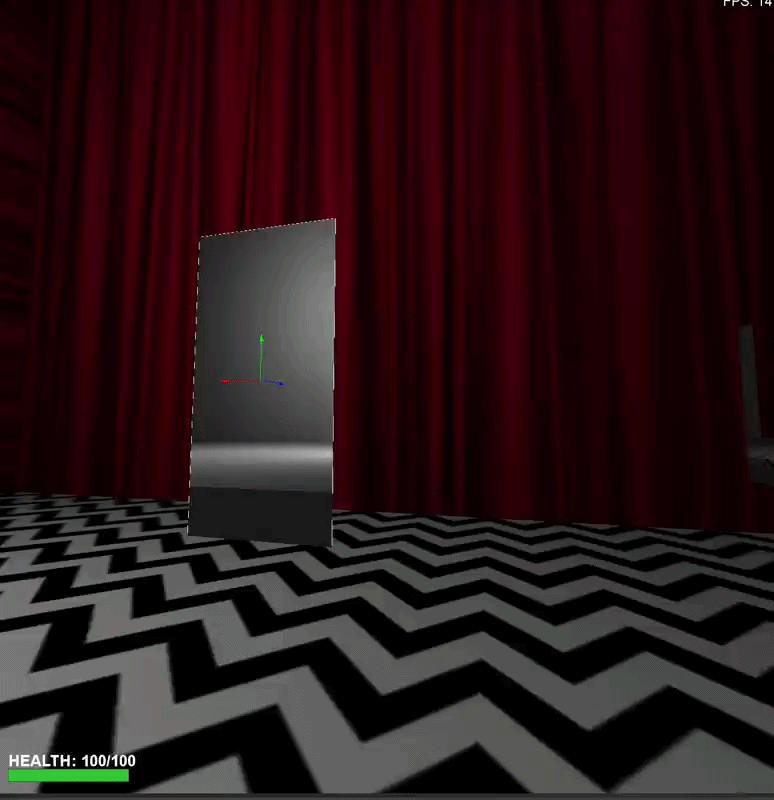

  

### Unified World Editor, Real-Time Engine & Game Creation Toolkit

**Fio is a real-time world machine for creating, editing and running first-person, top-down and large-scale worlds.**

Build a world, press **Play**, and the world you just edited becomes the running simulation.

There is no import, compile or bake stage between authoring and execution. **The editor and runtime operate on the same world state.**

Designed on low-power ARM hardware with an efficiency-first philosophy.

### What makes Fio different


* 1990s editor ergonomics + modern engine architecture
* **The world is executable** — entities, state, spatial relationships and gameplay logic are part of the live world.
* **Classic brush/CSG editing** with arbitrary convex polyhedra.
* **Entity I/O gameplay** inspired by Source, providing a composable alternative to traditional scripting.
* **LogicState**: persistent, typed state attached directly to world objects.
* **Large-world simulation** with spatial residency and distance-aware simulation
* **Dense numerical processing** using NumPy for bulk spatial, transformation and simulation operations.
* **Native world portals**: non-Euclidean connections between arbitrary locations without BSP/VIS preprocessing.
* **Procedural world generation** and experimental map-generation tools.
* **Continuous camera system** with first-person and top-down modes.
* **Physics, movers, triggers, timers, logic gates and pathfinding** as native world systems.
* **Fully extensible plugin architecture** with example plugins included.
* **Portable world packaging** through `.fiopak`.
* **Local split-screen multiplayer.**
* **Designed to bring back the immediacy of classic Radiant/Worldcraft workflows.**

### [💾 Download Binaries for Windows/macOS/Linux](https://github.com/ViciousSquid/Fio/releases)

### Documentation: [Wiki](https://github.com/ViciousSquid/Fio/wiki/) | [Changelog](https://github.com/ViciousSquid/Fio/wiki/changelog)

#### Or [run from source](https://github.com/ViciousSquid/Fio#-quickstart) or use the included Dockerfile.


---

##  The World Machine

a modern data-oriented engine wearing the skin of a 1998 GtkRadiant workflow, with Source-style entity I/O instead of a scripting language — deliberately recreating the immediacy of classic Radiant/Worldcraft, but where pressing Play just... runs the world you're editing.

A Fio world contains:

* geometry
* entities
* spatial relationships
* physical state
* gameplay state
* logic connections
* simulation state
* rendering state

The editor operates directly on that world.

When you press **Play**, Fio does not export the map into another representation and hand it to a separate game runtime. **The world continues running.**

```text
                    FIO WORLD
                       │
       ┌───────────────┼────────────────┐
       │               │                │
     EDIT           SIMULATE          RENDER
       │               │                │
       └───────────────┼────────────────┘
                       │
                  SAME WORLD
```

This is the core idea behind Fio:

> **The map is the program. The editor is the engine.**

---

## Why Fio exists

Fio explores what happens when the immediacy of classic Radiant/Worldcraft-style editing is combined with a modern real-time simulation architecture.

The goal is to reduce the distance between **authoring a world and experiencing it**.

Fio is designed for rapid experimentation with:

* first-person worlds
* top-down worlds
* large/open worlds
* procedural environments
* experimental gameplay systems
* non-Euclidean spaces
* reactive environments
* simulation-heavy maps

There is no requirement to build a conventional gameplay codebase before a world can become interactive.

Gameplay can be assembled from **entities, inputs, outputs, state and spatial relationships**.

---

## Logic & Gameplay

Fio uses an entity-based gameplay model built around **I/O and LogicState**.

Objects can send inputs to other objects, react to events, maintain persistent typed state and participate in larger gameplay systems.

### Native systems include

* LogicState
* Entity I/O
* Logic gates
* Relays
* Timers
* Triggers
* Movers and doors
* Physics
* Props
* Pathfinding
* Player starts
* Procedural terrain
* World portals
* BigWorld simulation-distance management

LogicState provides object-local typed state including strings, integers, floats, booleans, null values and UUIDs.

Rather than requiring a central quest or scripting runtime, gameplay can emerge from **small composable world behaviours**.

---

## Large Worlds

Fio is designed to make large worlds practical on relatively constrained hardware.

The spatial system maintains world locality through a grid-based spatial index. Systems can use that information for:

* visibility
* distance queries
* simulation residency
* physics synchronisation
* entity lookup
* culling

BigWorld builds on this infrastructure to control how much of the world needs to remain actively simulated.

World entities can move between different simulation-distance states rather than requiring every object in a large world to receive identical processing every frame.

This makes large worlds a **simulation problem**, not simply a rendering problem.

---

## Numerical Core

Fio is deliberately designed around bulk numerical processing where the workload benefits from it.

Large collections of homogeneous world data can be represented as dense arrays and transformed together using NumPy rather than repeatedly traversing thousands of Python objects.

This architecture is used for areas such as:

* spatial calculations
* distance/culling operations
* transformations
* physics synchronisation
* entity indexing
* bulk world-state operations

The goal is simple:

> **Don't make the CPU repeatedly perform work that can be expressed as a bulk data transformation.**

Scalar Python remains appropriate for small, irregular or highly stateful operations. Fio does not attempt to turn every part of the engine into an array.

---

##  Rendering

- Lean **OpenGL 3.3 Core** renderer designed with low-power hardware in mind.
- Operates directly on NumpY arrays

Features include:

* dynamic lighting
* dynamic shadows
* fog
* glass
* water
* frustum culling
* distance culling
* world portals
* GLB assets
* first-person and top-down camera modes

### Two renderers: Classic and HD_High

Fio draws through a renderer contract (`engine/renderer`), and ships two renderers that are swapped while it runs:

| | **Classic** | **HD_High** |
| --- | --- | --- |
| What it is | Fio's original forward renderer (`engine/renderer/forward`). The default. | A separate, physically based renderer (`engine/renderer/hd_high`). |
| Lighting | Lambert per lamp, in display space | Physically based surfaces (GGX specular, energy-conserving diffuse), a sun with a filtered shadow map, sky light, Forward+ clustered lamp culling |
| Materials | The diffuse texture | Diffuse + normal/height + AO/roughness/metalness/emission maps for every surface, parallax |
| Frame | Straight to the display | HDR target, ambient occlusion, screen-space reflections, bloom, sun shafts, tone mapping, grading, FXAA |

Each is documented in [`docs/renderers.md`](docs/renderers.md). Choose one in **Settings > Display > Renderer** (`[Renderer] renderer = Classic | HD_High` in `settings.ini`), or switch at any moment with the console's `r_renderer Classic` / `r_renderer HD_High`. No restart: the renderers share nothing but the contract. Low-power ARM mode always uses Classic, and the Android player is Classic only.

Classic is locked: HD_High is its own package and Classic's files, shaders and pixels are checked against what they were before HD_High existed (`tests/visual/test_classic_lock.py`, `tests/visual/test_classic_golden.py`, `tools/hd_golden.py`).

#### A map's HD sky

What an HD_High frame looks like is map data, kept where the sky image is: on the **primary PlayerStart**, under **HD Sky** in the property editor. Classic keeps these properties with the map and ignores them. All are optional.

| Property | Meaning | Default |
| --- | --- | --- |
| `hd_sky` | `none` (indoors: the map's own lamps and ambient, nothing else), `panorama` (the sky image is the sky and lights the map) or `procedural` (an analytic sky with clouds) | `panorama` if the map has a sky image, else `none` |
| `hd_sun`, `hd_sun_azimuth`, `hd_sun_elevation`, `hd_sun_color`, `hd_sun_intensity`, `hd_shadow_strength` | A directional sun with a shadow map. A blank colour is taken from the atmosphere. | on for `procedural`, off otherwise; 135°, 42°, 3.4, 1.0 |
| `hd_turbidity`, `hd_rayleigh`, `hd_mie`, `hd_mie_g`, `hd_ground_color` | The procedural atmosphere | 3.5, 1.4, 0.005, 0.8 |
| `hd_cloud_cover`, `hd_cloud_softness`, `hd_wind_x`, `hd_wind_z`, `hd_cloud_shadows` | The procedural cloud layer and its moving shadows | 0.42, 0.22, 26, 11, 0.55 |
| `hd_haze`, `hd_haze_falloff` | Aerial perspective under a sky. A map with distance fog switched on uses its fog instead: one or the other, never both. | 0.00003, 0.0008 |
| `hd_exposure` | Exposure compensation in stops (EV) | 0 |
| `hd_bloom`, `hd_ao`, `hd_tint`, `hd_saturation`, `hd_contrast`, `hd_vignette`, `hd_grain` | The look of the finished frame | 0.10, 1.0, white, 1.04, 1.05, 0.22, 0.012 |

How light behaves:

* **A map with no sky is lit exactly by its lamps**, at the brightness Classic shows it: a lamp falls off across a room as its author saw it, and the frame is not lifted toward mid-grey.
* **Under a sky, sky light lands only on what can see the sky.** A courtyard is lit by the sky, daylight comes in at a window or a doorway, and the rooms beside it are lit by their lamps; nothing leaks through a roof or a wall.
* **Exposure is worked out, not authored**: from the sky's and sun's light outdoors, held at classic brightness indoors, and eased between the two by how much sky is over the view point. `hd_exposure` nudges it.
* **Reflections** show the frame itself where a reflected ray finds it; otherwise the nearest ReflectionProbe, else the sky, else the map's ambient.
* **Terrain** under a sky is shaded like every other surface (sun, sky light, shadows, its layers' normal maps).
* Sprites, monsters, particles, effects, water and glass are not physically shaded: they keep the colours they have in Classic, through the tone curve.

View > **HD preview** chooses whether the editor's 3D view is drawn in HD while HD_High is active (Play always is).

#### Material maps

In HD_High no surface is flat for want of maps. Beside a diffuse texture `<name>.<ext>` (png, webp or jpg):

| File | Contents |
| --- | --- |
| `<name>_n` | Tangent-space normal map, OpenGL convention (+Y up), with the surface's **height in alpha** (or in a separate `<name>_h`) |
| `<name>_m` | **R** ambient occlusion, **G** roughness, **B** metalness, **A** 1 − emission |
| `<name>.mat.json` | `parallax` (relief depth in world units), `emission` (gain), and the generator's inputs |

Every stock surface texture has a set, baked from its picture by `tools/make_material_maps.py` (parameters per texture in its `.mat.json`, so a result can be tuned and reproduced; hand-made maps are never overwritten). A texture with none gets them made by the same generator when it is first drawn, off the render thread, and kept in the user's cache by the picture's content. Tool textures (nodraw, trigger, the Dev grids) are flat on purpose. **Tools > HD Readiness Report** lists where each texture the open map uses gets its maps.

GLB materials' roughness and metalness factors and an MTL's `Pr` / `Pm` / `Ke` are used by HD_High; Classic ignores them.

#### What HD_High costs

`tools/bench_hd.py` draws stock maps with both renderers and reports GPU time (whole frame and per pass), CPU time and the video memory HD_High adds. See `docs/hd_high_performance.md` for a measured table and how to read it.

### Native world portals

Fio supports non-Euclidean world connections between arbitrary locations using portal rendering techniques including stencil-buffer masking and oblique near-plane clipping.

There is no requirement for BSP, VIS/PVS preprocessing or offline visibility compilation.

---

##  Under the Hood

### Shared runtime state

The editor and simulation operate on the same live world representation.

Pressing **Play** does not require Fio to compile or bake the level into another runtime representation.

### Data-oriented where it matters

Fio combines Python's high-level flexibility with C-accelerated numerical processing through NumPy.

Large homogeneous datasets are processed in bulk, while irregular gameplay and editor operations remain straightforward Python.

### Spatially aware simulation

The spatial system provides a common foundation for visibility, culling, entity lookup and large-world simulation.

BigWorld uses this infrastructure to determine which parts of a world need full, reduced or dormant simulation.

### Extensible architecture

Fio is open-source and modular, with a plugin API for extending the editor and runtime.

The goal is not to hide the engine behind layers of abstraction, but to make experimentation with the world machine straightforward.

---

## 📦 Portable Worlds

Fio can package worlds and their associated resources into `.fiopak` archives.

The eventual goal is simple:

> **A complete Fio world should be something you can hand to another Fio runtime and run.**

The same engine architecture is also being developed toward a dedicated player for portable platforms.

---

## 🚀 Quickstart

Fio requires CPython 3.13 or newer (GIL-enabled); releases are built with 3.14. Free-threaded Python is not supported.

```bash
git clone https://github.com/ViciousSquid/Fio.git
cd Fio
python -m venv venv
source venv/bin/activate  # or venv\Scripts\activate on Windows
pip install -r requirements.txt
python main.py
```

---

## 🤝 Contributing

Contributions, feedback and experiments are welcome.

Fio is an active research-and-development project as much as it is a game creation toolkit. If you're interested in world editing, procedural generation, simulation, rendering, spatial systems or unusual gameplay architectures, check the issues and discussions.

---

<br>



[](https://www.youtube.com/embed/ANNXNGgn_wo)


