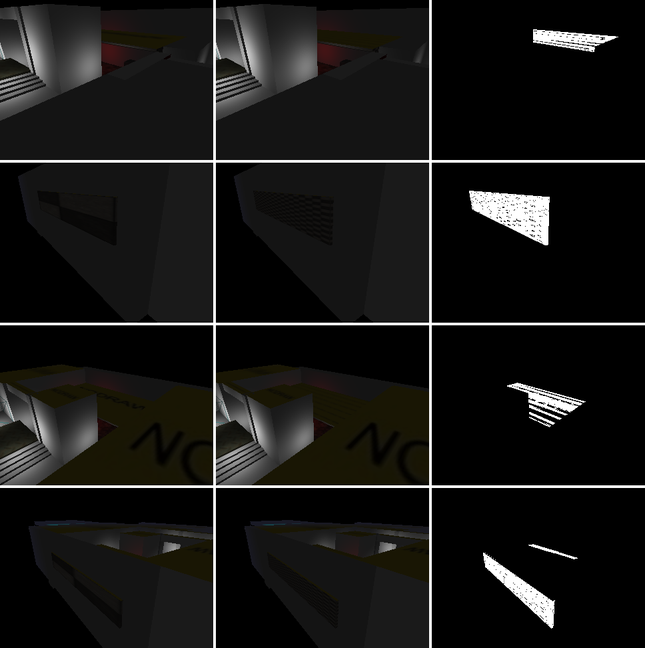

# Unified brush model — investigation and migration proposal

Status: **Stage 0 implemented** (guard rails, characterisation tests and
baselines; no behaviour change) and **Stage 1 implemented** (one material
record per face). Stage 2 is designed (`docs/brush-model-stage2.md`, awaiting
approval); Stages 3–4 are proposals. Written after M2 (`5b26ede`),
which exposed the problem while keying convex GPU meshes.

Goal: one authoritative definition of every brush, two efficient geometry
encodings (compact AABB, arbitrary convex), specialised algorithms for each,
one transform model, one material model, one GPU-ready publication contract
— with no regression for AABBs, which are ~99 % of brushes.

Migration invariant: **every AABB keeps using the existing shared cube
geometry.** Changing the brush model must not introduce per-AABB vertex
allocations, plane tessellation, plane dictionaries or duplicated cube
meshes. One brush abstraction, two specialised geometry paths, one shared
cube VBO for all ordinary AABBs.

## What exists today

Fio began AABB-only; angled brushes were added later on top. A brush dict is
read under two models that overlap without one being authoritative:

| | AABB brush | convex ("angled") brush |
|---|---|---|
| geometry | `pos`, `size` | `geometry.planes` (world space) |
| `pos`/`size` | the geometry | a derived bound (`sync_brush_bounds`) — and the mesh's anchor |
| face material | per-tag dicts: `textures`, `uv_scale`, `uv_angle`, `uv_shift`, `uv_natural`; brush `texture_tiling` | per plane: `texture`, `uv_scale`, `uv_angle`, `uv_shift`, `uv_u`/`uv_v`, `uv_natural` — **and** the per-tag dicts |
| textured or solid pass | any real texture in `textures` | the same rule, from the per-tag copy, not the planes |
| rotation | `_rot_angle`/`rot_axis` (runtime; movers, savegame) | planes rotated (`rotate_brush`) and `_rot_angle` |
| runtime motion | `pos` written per tick; `original_pos` restores it | the same — the drawn mesh follows, the collision mesh does not |

`pos` alone has ~320 read/write sites, `size` ~140, `textures` ~85, plugins
included; ten modules branch on the encoding (`brush_geometry`,
`render_table`, `logic_collision`, `qt_game_view`, `renderer/core/overlays`,
`editor/main_window`, `editor/view_2d`, `editor/component_edit`,
`editor/face_texture`, a tool).

## Stage 0 — what is pinned (implemented)

No engine or editor code changed. Everything below is tests, fixtures and
tools.

* **An executable statement of today's semantics**
  (`tests/helpers/brush_semantics.py`): for a brush dict, its encoding, the
  pass that draws it, the faces drawn (world-space polygon and resolved
  material), the bound the bound-readers use, the transform, and every
  inconsistency it carries. GL-free.
* **Anchored to the engine, not to an opinion of it**
  (`tests/brush_model/test_semantics_anchor.py`): on every brush of every
  shipped map and on synthetic brushes covering each rule — box faces
  against the RenderTable columns the instanced box pass draws from
  (including the natural/tiling rule); convex faces against the frozen
  convex path (vertices through the published model matrix, and each run's
  face state), which `test_geo_run_parity` proves against the GPU; bounds
  against the RenderTable, `brush_aabb_bounds` (float32, as physics and AI
  read it) and the collision rows; the pass against the class bit; the
  transform against the rotation column. And at the GPU itself
  (`tests/visual/test_brush_semantics_gl.py`): the faces whose two material
  homes disagree are read back triangle by triangle through the draw oracle,
  so "this edit does not render" is a statement about GPU state.
* **Per-map snapshot** (`tests/brush_model/semantics_snapshot.json`,
  `test_semantics_snapshot.py`): every shipped map's encodings, a digest of
  the drawn faces, materials, passes and bounds (to 1e-4 of a unit), and the
  exact per-brush inventory of inconsistencies. A stage that changes a
  shipped map's meaning regenerates it in the same commit
  (`python tools/brush_semantics_snapshot.py --write`) and names the change.
* **Known inconsistencies pinned both ways**
  (`tests/brush_model/test_known_inconsistencies.py`): each is asserted as it
  behaves today *and* as the target contract, the latter
  `xfail(strict=True)` with the stage that delivers it. A stage cannot fix
  or break one silently: the characterisation test fails and the target
  passes unexpectedly.
* **Write-site ratchet** (`tests/brush_model/write_sites.json`,
  `test_write_sites.py`): per module, the code writing `pos`, `size`,
  `geometry`, the per-tag material dicts, `texture_tiling`, `original_pos`,
  `_rot_angle`, `rotation_yaw` (92 writes in 16 modules today). It may only
  go down.
* **AABB invariant** (`tests/visual/test_aabb_shared_cube.py`): in a box-only
  world, in textured, flat and wireframe modes, editor and play, with
  shadows: no convex machinery runs (no plane set, solve, record,
  tessellation or store page); every draw takes its positions from a buffer
  all boxes share (cube VBO, unit-cube edge VBO, occlusion probe cube) or
  none; growing the world tenfold creates no buffer or vertex array and the
  instanced passes issue the same draws; a frame leaves box dicts unchanged.
* **AABB budgets** (`tests/brush_model/test_aabb_budgets.py`, `perf`):
  heap per box dict, RenderTable column and retained bytes per row, and that
  projecting boxes adds no keys and solves nothing.
* **Baselines** (`tools/bench_brush_model.py`): memory, table sync, edit
  latency through `EditorState`, undo/redo, retained history, steady
  rendering.

## Stage 0 findings

Measured on this branch; "shipped" means one of the 20 maps in `maps/`.

**Face material (two homes).**

1. *Surface Inspector edits of a tagged angled face do not render.*
   `face_texture.set_transform` writes a tagged face's shift, scale and
   angle to the per-tag dicts and reads them back from there; the convex
   path draws the plane's values. Confirmed from GPU state. Texture is the
   one field written to both homes, so retexturing works.
2. *In shipped data:* four convex brushes in `_SHOWCASE` carry a per-tag
   `uv_scale` their planes lack; the inspector showed it, the viewport drew
   1.0 (fit). (Corrected at Stage 1: the values are 0.25 on one brush — its
   top face 2.625 × 1.3125, but Natural — 10 × 8 on another, and 1.0 on the
   other two, which therefore drew as authored all along.)
3. *Converting a box to convex drops its shift and angle.*
   `box_to_geometry` (and the first-edit seeding in `sync_brush_bounds`)
   carry textures and scales onto the planes, not shifts, angles or natural
   flags; the first clip, vertex drag or rotation of a mapped box resets
   the mapping on screen.
4. *Natural scale on a cut face never renders.* The editor writes
   `uv_natural` on the plane for a cut face; the renderer resolves convex
   natural mode from the per-tag flags only.
5. *`texture_tiling` does not reach convex faces* (boxes draw unscaled faces
   natural; the convex path draws them fitted).
6. *Pass routing reads the per-tag copy.* An angled brush whose only real
   textures are on planes — a cut face textured by the clip tool or the
   inspector on an otherwise untextured box — goes to the solid pass and is
   drawn entirely in its colour. Confirmed from GPU state; no shipped map.

**Position and bounds.**

7. *Bounds drift.* Seven shipped convex brushes have `pos`/`size` that are
   not their planes' AABB bit for bit: four by float noise (≤ 6e-11), one by
   4.85e-5 (`Angled_Brush_Test`; that bound is 2.4e-5 *smaller* than its
   geometry) and two by 128 units (`Terrain_Test_small`, `Topdown_example`;
   larger bounds). Culling, collision broad-phase, picking and the spatial
   grid read the bound, so they are conservative to within 1e-4; deriving
   bounds will tighten those two maps' culling and broad-phase, not change
   their pixels.
8. *What is drawn depends on history.* A convex mesh is anchored to
   `pos`/`size` when its record is made and kept while the planes are
   unchanged, so a `size`-only change to an existing convex brush (console
   `setprop`, a plugin) stretches it until the map is reloaded, when the
   planes are drawn where they are.
9. *Convex movers do not collide as their shape.* Movers write `pos`; the
   drawn brush follows. (Corrected in the Stage 2 investigation: play builds
   no mesh collision for movers — `angled_brush_is_solid` excludes them — so
   an angled mover collides as its `pos`/`size` box, which follows it but has
   the wrong shape; the triangles are absent, not stale. The Stage 0
   characterisation test builds them by hand and is replaced in Stage 2.)
   No shipped map has a convex mover.
10. *Play state is saved.* Movers write `original_pos`, `_rot_angle` and
    `rotation_yaw` into the authored dict and the serialiser keeps them:
    seven shipped maps carry `original_pos`, one `rotation_yaw`.
11. Physics and AI read the bound rounded to float32 (`brush_aabb_bounds`,
    through GLM); the RenderTable and collision rows read it in float64.
    Consistent with `pos`/`size`, but a third numeric reading to keep.

**AABB rendering and editing.**

12. Every box is drawn from the shared cube VBO by instanced passes; the
    draw count does not depend on the number of boxes. Exception: wireframe
    mode issues one `glDrawArrays` per brush (from the shared edge buffer:
    a submission per box, not an allocation) — an M5 candidate.
13. Editing cost on large AABB worlds is the undo checkpoint, not the
    tables: each edit serialises the whole world (1.10 MB of JSON on
    BigWorld, ~11 ms) while the table refresh is ~0.2 ms; undo/redo take
    68–70 ms (restore ~25 ms, table reconcile ~43 ms). The 50-entry history
    retains up to ~55 MB on BigWorld. Not a brush-model problem, but every
    stage must keep it from growing (a canonical record must not make the
    snapshot larger).

## AABB baselines (CPython 3.13, llvmpipe, x86-64)

| | BigWorld (3,604 boxes) | `_SHOWCASE` (68 boxes, 17 convex) |
|---|---|---|
| heap per box dict | **1,358 B** (budget 1,359) | 1,389 B |
| heap per convex dict | — | 5,670 B |
| RenderTable column bytes per row ¹ | **353 B** | 353 B |
| RenderTable retained heap per row ² | 541 B | 2,916 B |
| full table sync (warm / cold) | **40–42 ms** / 41–54 ms | 1.9 / 10.6–16.5 ms |
| one-row refresh (move) p50 / max | 0.07–0.09 / 0.20 ms | 0.05 / 0.14 ms |
| edit: move, resize, retexture, UV p50 | 11.1–12.3 ms (checkpoint ~11) | 1.3–1.4 ms |
| edit: create / delete p50 | 16.1 / 17.2 ms | 1.5 / 1.6 ms |
| undo / redo p50 (p99) | 67.7 (88.3) / 69.6 (110) ms | 14.7 (21.4) / 15.1 (23.8) ms |
| undo checkpoint | 1.10 MB | 64 KB |
| still frame render CPU p50 / p95 / p99 / max | 9.3 / 13.9 / 14.9 / 27.9 ms | 8.1 / 10.7 / 11.2 / 11.5 ms |

¹ The fixed layout: the item size of every per-row column, summed
(`render_table._COLUMNS`). Independent of the map. ² What a synced table
retains, measured with `tracemalloc` in a fresh interpreter and divided by
its rows: the columns at their allocated capacity plus the per-row id list,
the id → slot map, interned texture names and, for angled rows, the
geometry records. It grows with angled brushes (`_SHOWCASE`) and is the
number to compare for memory; ¹ is the number to compare for layout.

Ranges are two runs on a shared machine. Reproduce:

```bash
xvfb-run -a env LIBGL_ALWAYS_SOFTWARE=1 python tools/bench_brush_model.py --render --json base.json
```

## Target model

One record per brush; derived data is never saved and never written by
editing code.

* **`shape`** — exactly one encoding:
  * `box`: `size` (half-extents implied). Fixed topology: six faces with
    fixed tags, no planes, no solver. This is today's AABB, unchanged, drawn
    from the shared cube VBO.
  * `convex`: the plane set (normal, offset per plane). Solved once into
    windings when it changes (as now), cached by content.
* **`transform`** — the only placement: `pos` (box centre; convex
  reference point) plus optional rotation. Authored; never written by the
  runtime.
* **`faces`** — one material/UV record per face, the only one: `texture`,
  `uv_scale`, `uv_angle`, `uv_shift`, `uv_natural`, and for convex faces the
  texture basis. For a box, the per-tag dicts are that record (six entries,
  no plane dicts); for a convex brush, the planes.
* **Runtime state** (movers, doors): a displacement held by the
  `MoverTable` and published as a transform column; authored `pos` stays
  put, so `original_pos` disappears.
* **Derived** (cached, rebuilt on change, never saved): world bounds,
  convex windings and collision meshes, render records, the pass a brush is
  drawn in.

Specialised algorithms stay specialised: boxes keep the cube VAO and the
instanced face path, dense `(N, 6)` face columns, AABB collision arrays and
cell bucketing; convex brushes keep windings, mesh collision and the M2
shared store. The publication contract: one RenderTable row per brush with
an encoding bit, transform columns, and either the six face columns or a
geometry handle into convex records — what exists today, minus the
duplicated inputs.

## Incremental migration

Each stage ships on its own and must meet the gates before the next starts.

0. **Guard rails, no behaviour change.** Done (above).
1. **One face record.** Done (below).
2. **Unambiguous position** — investigated and designed in
   `docs/brush-model-stage2.md` (awaiting approval). Movers stop writing `pos`: their displacement
   is a runtime transform column (the MoverTable already owns dense
   positions), applied to drawing and convex collision alike. Convex
   `pos`/`size` become derived and read-only; a convex mesh depends on its
   shape and faces only (the anchor becomes the shape's own frame), so what
   is drawn no longer depends on history. Play state leaves the authored
   dict. The two maps whose bounds are 128 units off get exact bounds:
   tighter culling and broad-phase, identical pixels; called out and tested.
   **Mandatory for this stage — angled-mover collision:** an angled mover's
   collision triangles are baked in world space at play start and do not
   follow its displacement (finding 9; pinned by
   `test_a_convex_movers_collision_mesh_stays_where_play_started` and its
   strict-xfail target). Stage 2 is not done until the target passes: the
   mover's transform is applied to its convex collision (planes, triangles
   and broad-phase bounds) as it is to its drawing.
3. **Compact encodings in the tables.** RenderTable/EntityTable keep the box
   columns as they are; convex rows reference cached shapes. No change for
   boxes beyond reading the same values from the canonical record.
4. **Save format v5.** Writes the whole canonical record (Stage 1 took map
   version 4 for the face layout); earlier versions load through
   migrations; round-trip tests; compatibility keys for plugins for one
   release (read-only views of `pos`/`size`/`textures`), then removed.
   **Mandatory for this stage — undo checkpoint cost:** every edit
   checkpoints the whole world as one JSON string (finding 13: 1.10 MB and
   ~11 ms per edit on BigWorld, undo/redo 68–70 ms, up to ~55 MB of history).
   With a canonical per-brush record the checkpoint can hold only what an
   edit touched (per-brush serialised records shared between checkpoints, or
   deltas). Stage 4 is not done until edit p50 on BigWorld is dominated by
   the edit rather than the checkpoint, and history no longer scales with
   world size × steps. Until then every stage keeps the checkpoint from
   growing (a gate below).

## Stage 1 — one face record (implemented)

Scope: face material only. Geometry, transforms, bounds, the shared cube
VBO, the AABB render path, the fixed six-face RenderTable columns and the M2
batching are unchanged; boxes keep their per-tag dicts and every fast path.

### Model

Every face has exactly one material record — `texture`, `uv_scale`,
`uv_shift`, `uv_angle`, `uv_natural` — in one home:

* a box face: the brush's per-tag dicts (as before; no plane dicts);
* an angled-brush face, tagged or cut: its plane, and only its plane.

Brush-wide `texture_tiling` applies to both encodings: an unscaled face that
is not Natural keeps a constant texel size.

`engine/brush_faces.py` (GL-free) is the single accessor: `face_record` /
`face_material` / `plane_material` read; `set_face_material` writes the one
home; `tag_material_onto_planes` / `planes_onto_tags` convert between the
encodings; `face_textures` / `is_textured` / `box_material_dicts` serve
classification and box-making tools; `migrate_legacy` is the load-time
migration and `legacy_layout` / `export_legacy_level` the explicit legacy
export. At run time nothing reads a per-tag dict for an angled face: a
stray per-tag entry on an angled brush (a plugin, a hand edit) is ignored,
never promoted, so an obsolete value cannot come back — a disabled Natural
flag stays disabled through edits, vertex drags, box round trips, undo and
save/reload.

### Legacy migration and its precedence rule

Maps saved before the canonical layout (map `version` < 4, or no version)
are migrated once, when they are loaded. For each tagged angled face whose
field has a value both in a per-tag dict and on its plane, the precedence
rule (`brush_faces.PRECEDENCE`) picks the authoritative one, writes it to
the plane and drops the copy. It applies only there, never at run time.
Specified case by case in `tests/brush_model/test_face_precedence.py`:

| field | per-tag only | plane only | both, differing |
|---|---|---|---|
| `texture` | plane (default) | plane | **plane** |
| `uv_scale`, `uv_shift`, `uv_angle` | per-tag | plane | **per-tag** |
| `uv_natural` | set | set | set if either |

Not "the per-tag value wins". The rule follows from which code wrote each
home before Stage 1:

* texture — every editor path that textured a tagged angled face (the
  Surface Inspector, apply-to-face) wrote the plane, and the plane is what
  was always drawn; the only writers of a per-tag texture alone on an
  angled brush were autocaulk and the trigger toggle, which judge faces by
  the brush's AABB (a sloped face is not an AABB face) and were never drawn.
* scale, shift, angle — the Surface Inspector, Fit, Natural and the
  Page Up/Down rotation wrote these to the per-tag dicts and the inspector
  displayed them; nothing in the editor wrote a tagged plane's mapping. A
  plane value on a tagged face is a copy made at conversion, or the only
  value there is (generated or hand-made brushes), so an authored per-tag
  value is the newer one and a plane value stands where none was authored.
* Natural — set in either place means Natural, as the inspector showed it.

The test oracle (`tests/helpers/brush_semantics.migrated`) restates the
migration independently and is checked against the engine's on every brush
of every shipped map.

### Map compatibility

* **Versioned.** Saves are map `version` 4 (`CANONICAL_MAP_VERSION`); the
  loader migrates version < 4 only. In a version 4 map the plane is the
  record by definition: a stray per-tag copy is dropped, not consulted.
* **No dual write.** A normal save carries no per-tag copy on any angled
  brush. Undo checkpoints are the same canonical form.
* **Streamed worlds.** Loading a streamed Big World map of version < 4
  migrates every brush record, resident or not, so a later save writes no
  legacy record into a version 4 file.
* **Older builds** get an explicit export, never a dual-written save:
  `tools/export_legacy_map.py IN OUT` (`brush_faces.export_legacy_level`)
  fills each angled brush's per-tag dicts from its tagged planes and writes
  version 3; it lists the faces the old layout cannot express (Natural on a
  cut face, tiling on an angled brush), which an old build draws as it
  always did. Loading such an export in this build gives back the same
  records.
* **Android.** The player (not modified) already draws angled faces from
  their planes (Natural from either home, tiling applied) and packages plane
  textures. Checked on every shipped map: the player's batch builder gives
  identical output for the original file and its canonical save, except the
  two `_SHOWCASE` brushes below (it now draws their authored scale, as the
  desktop does), and the packaged texture set is identical. The shipped map
  files themselves are still version 3 until re-saved.

### Tools through the accessor

The Surface Inspector (`editor/face_texture.py`), apply-texture-to-face and
Page Up/Down rotation (the whole-brush form now turns every face of an
angled brush, cut faces included) read and write the one record. Converting
a box to angled (`box_to_geometry`, the first vertex drag, the first clip or
rotation) moves all five fields onto the planes, and writes the cube's own
texture basis onto the two X-facing sides: the cube maps those with U up the
wall, the convex default projects U along Z, so a converted box showed
those two textures turned 90° (before and after Stage 0 alike). A box and
the brush converted from it now draw bit-identical pixels from every side,
plain, scaled, shifted and rotated. Returning to a box (component commit,
reset, simplify: `brush_geometry.drop_geometry`) moves the record back; a
component drag's cancel restores the per-tag dicts too. The vertex-drag rebuild
(`carry_plane_metadata`) keeps shift, angle and Natural with each face (it
kept only texture and scale, so cut faces lost their mapping on every vertex
drag). The clip tool keeps every surviving face's record; the cut face
inherits the brush's dominant texture and scale as before. CSG subtract
fragments and hollow shells take every field of every tagged face
(`box_material_dicts`) and brush-wide tiling (they took the textures only).
Autocaulk writes a box face's record and leaves angled brushes alone (its
occlusion test samples AABB faces, which a sloped face is not). The trigger
toggle textures every face through the accessor, the bottom face included
(the old list named it `bottom`, which no face is called). The property
panel ignores face-material keys when deciding to rebuild (it never displays
them; they move when a box becomes angled).

The renderer resolves each angled face's material once, into the geometry
record (`GeometryRecord.materials`, part of the mesh cache key). Pass and
water classification read the faces' records.

### Intentional rendering changes (separate from M1/M2 parity)

**On shipped maps:** exactly two brushes, both in `_SHOWCASE`, draw
differently (`tests/brush_model/test_stage1_changes.py` lists every changed
face; `tools/compare_map_pixels.py` confirms it in pixels):

| brush | faces | drawn before | drawn now (authored) |
|---|---|---|---|
| `5b10b49b…` | west, down, north, south | 1.0 (fit) | 0.25 × 0.25 |
| `8c04e483…` | all six | 1.0 (fit) | 10 × 8 |

`5b10b49b…`'s top face carries 2.625 × 1.3125 but is Natural, before and
after. The other two brushes Stage 0 listed (`908d6864…`, `e4b232de…`)
carry an authored 1.0, which draws exactly as their planes' missing scale
did. Every other sampled view of the 20 shipped maps (6 views each; 19 maps,
114 images) is pixel-identical to Stage 0; in `_SHOWCASE` every differing
pixel lies where the two brushes are seen, and with them removed the
renders are identical.



**For brushes made in the editor from now on** (no shipped map has these):
Surface Inspector scale, shift, rotation and Natural edits of angled faces
render; box-to-angled conversion keeps every face's mapping and the box's
texture orientation; an angled brush textured only on its planes uses the
textured pass; Natural on a cut face and brush-wide tiling apply to angled
faces.

**Caulk-only angled brushes.** The M1/M2 parity fixture held an angled brush
whose planes were all caulk while its per-tag dict named a real texture.
Before Stage 1 that brush reached the textured pass through the per-tag copy
and drew nothing, unlike an angled brush whose two homes both said caulk,
which (like a caulk-only box) went to the solid pass. Its faces' record is
caulk, so it now goes to the solid pass like every other caulk-only brush:
`tests/visual/test_brush_semantics_gl.py::test_a_caulk_only_angled_brush_*`
keeps the original scenario and checks that all three layouts (that mixed
one, a consistent legacy one, a canonical one) classify, collide and draw
identically — textured, flat and wireframe editor modes and play — with no
caulk face ever drawn by a textured program, and as the caulk-only box is
classified (collision: the same solid mesh for all three, as before). No editor operation produced that mixed layout and no shipped
map has it. The parity fixture now gives the brush one textured face,
because its purpose there is caulk faces *inside* the textured pass, which
needs a genuinely textured face. Open for review, unchanged: a caulk-only
brush, box or angled, is drawn by the solid pass in its colour in play too.

**M1/M2 batching parity** is still proved against the frozen reference
(`tests/helpers/geo_reference.py`, not modified). That frozen path read a
tagged face's Natural from the per-tag dicts, so the parity tests hand it
each brush through the explicit legacy export (`tests/helpers/legacy_view`)
— the layout it was written for — and refuse any face that layout cannot
express. Stage 1's own rendering changes are proved against the GPU state
separately (`tests/visual/test_brush_semantics_gl.py`, which also keeps
`Angled_Brush_Test.json` through load, Surface Inspector edits, save and
reload).

### Validation

**Regression suite** (everything except benchmarks; llvmpipe, x86-64):
Stage 0 at `a820c40`: 6,784 passed, 150 skipped, 10 xfailed, 5 failed.
Stage 1: 6,904 passed, 150 skipped, 4 xfailed, 7 failed on the first run —
the same five pre-existing failures (play-cycle leak, editor chrome, three
portal-fade) and two guards of things Stage 1 changes on purpose: a test
pinning the saved map `version` at 3, and a source-text guard naming the old
cut-face call in apply-texture-to-face. Both updated (the second now backed
by a behavioural test of applying a texture to a cut face) and re-run with
their directories: no failures beyond the five. The six Stage 1
strict-xfail targets now pass as regression tests; the four Stage 2
targets remain xfail.

**Pixel parity** (`tools/compare_map_pixels.py`, base `a820c40`): 19 of 20
shipped maps identical in all 114 sampled views; `_SHOWCASE` differs only
where the two corrected brushes are seen, identical with them removed.

**Performance** — Stage 0 vs Stage 1, same machine, interleaved runs (the
machine ran slower than when the Stage 0 baselines above were taken; both
trees moved together):

| BigWorld (3,604 boxes) | Stage 0 | Stage 1 |
|---|---|---|
| heap per box (budget 1,359 B) | 1,358.2 B | 1,358.2 B |
| RenderTable column bytes per row | 353 B | 353 B |
| RenderTable retained heap per row | 540.8 B | 540.9 B |
| full sync, warm — median of 5 interleaved rounds (range) | 48.6 ms (48.3–51.1) | 49.4 ms (46.7–51.7) |
| one-row refresh — median (range) | 0.083 ms (0.083–0.088) | 0.085 ms (0.082–0.086) |
| still frame p50, three rounds | 12.1 / 11.4 / 10.5 ms | 12.6 / 10.4 / 10.7 ms |
| still frame p95, three rounds | 17.7 / 17.2 / 16.9 ms | 18.8 / 16.3 / 17.1 ms |
| draw calls per frame | 1 | 1 |
| edit p50 move / retexture / UV | 16.9 / 15.1 / 14.8 ms | 18.1 / 14.9 / 14.9 ms |
| undo / redo p50 | 89.9 / 92.0 ms | 91.7 / 94.5 ms |
| undo checkpoint | 1.10 MB | 1.10 MB |

Every range overlaps: no measurable change for boxes. Angled brushes pay
for the per-face material record once per shape: on `_SHOWCASE` (17 angled
brushes) warm sync 2.34 → 2.45 ms, retained heap per row 2,920 → 3,053 B
(the resolved materials, cached on each shape); still frame p50 10.2 / 7.7 /
9.5 → 8.0 / 7.5 / 9.2 ms, 47 draws both; the undo checkpoint is smaller
(64.1 → 61.7 KB: no duplicated material).

### Outstanding issues after Stage 1

Recorded, not changed in this stage:

1. **Box path: Natural on the X-facing sides uses swapped extents.** The
   instanced box pass computes a ±X face's Natural repeats from (Z, Y),
   while the cube maps U along Y on those faces, so the texture is
   stretched there whenever a box's height and depth differ. Pre-existing;
   the box path must not change in Stage 1. A box converted to angled draws
   the correct constant texel size on those faces (the one case where
   conversion does not reproduce the box's pixels). Fixing it changes how
   existing boxes draw, so it needs its own decision.
2. **Caulk-only brushes are drawn in play.** A brush whose every face is
   caulk (box or angled) goes to the solid pass and is drawn in its colour,
   in play as well as in the editor. Pre-existing for boxes; Stage 1 makes
   angled brushes follow the same rule. Caulk is meant to be invisible, so
   this needs review; changing it changes how existing boxes draw.
3. **Intentional correction — the trigger toggle now textures the bottom
   face.** It wrote `trigger.jpg` to the faces named `top`, `bottom`,
   `north`, `south`, `east`, `west`; no face is called `bottom` (it is
   `down`), so a box trigger's underside kept its old texture. Through the
   accessor it now textures every face, the underside included, and an
   angled brush's faces too (before, it wrote per-tag entries an angled
   brush never drew).
4. **The shipped map files are still version 3.** They load through the
   migration; re-saving one writes it canonical. Until `_SHOWCASE.json` is
   re-saved, the Android player (which reads the file as it is) draws its two
   corrected brushes at 1.0.
5. **Stage 2, mandatory:** angled-mover collision must follow the visible
   brush, and derived bounds must be consistent (the 128-unit drifts).
6. **Stage 4, mandatory:** replace full-world undo checkpoints with an
   incremental mechanism.
7. Wireframe mode draws each brush's edges with its own draw call (an M5
   candidate).

## Gates (every stage)

Performance (same machine, base vs branch): box dict heap ≤ 1,359 B;
RenderTable column bytes ≤ 353 per row; table sync ≤ +5 %; steady render
unchanged within noise on `_SHOWCASE`, BigWorld and the angled benchmark;
edit, undo and redo p95/p99 unchanged; undo checkpoint not larger (until
Stage 4 makes it proportional to the edit); collision step and map load
≤ +5 %.

Correctness: the semantics snapshot unchanged except where a stage names a
deliberate change; draw-oracle parity (pixels and per-triangle state); the
AABB shared-cube guard; collision and picking reading the same bounds;
undo/redo and save/load round trips; Big World streaming; savegames;
plugin API contract tests.

## Open questions

* Rotation: a box with a rotation is not an AABB. Keep rotated boxes as the
  box encoding plus a transform (cheap), or convert them to convex on
  rotate (today's editor behaviour)? Proposed: keep today's editor
  behaviour, and use the transform rotation only for runtime motion.
* Whether convex planes should move to brush-local space. Rebasing changes
  float values; proposed only if Stage 2 shows a need, with an explicit
  tolerance-based parity rule.
* Compatibility of Stage 1's normalisation with older builds: a plane-level
  natural flag written by Stage 1 is ignored by a build from before it (the
  face renders fitted there).
