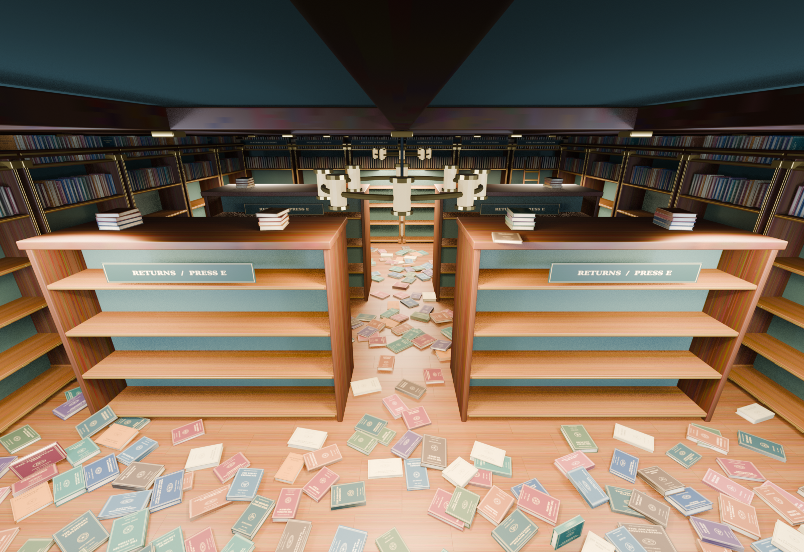

# Lantern House - The Great Book Tidy

[Playable .fiopak](Lantern_House.fiopak) · [OBJ and editable source bundle](Lantern_House_OBJ_and_Source.zip)

In Fio choose **Tools > Play Game Package...** and select `Lantern_House.fiopak`. For editing, unpack the source bundle into a Fio project and open `maps/Lantern_House.json`, then press Play. Use a current Fio build with the **Tidy 2.0 plugin installed** (the workspace build includes it). Tidy is automatically activated by this map. A .fiopak contains world data and assets; Fio requires plugins to be installed separately and rejects bundled plugin code.

Move with WASD, look with the mouse. Look down at a loose book and press **E** to carry it. Approach any empty lower shelf, aim at the small brass shelf markers, and press **E** to put it away. The Tidy HUD counts all **384** books. All books fit in **408** return slots. A green light at the entrance switches on when the goal is complete.

The 18 tall cases have four lower return shelves each and two upper collection shelves. Four double-sided islands provide four return shelves per side. Upper collection volumes are fixed room detail and do not count toward the task. Every visible book has a distinct title; the catalogue lists every volume actually present. Collection shelves have individually mapped title/spine art in a shared atlas.

The floor mess is a real **Blender/Bullet rigid-body result**. The 384 books were spawned 4.75-5.90 m above the floor with random orientations and varied dimensions, then dropped under 9.81 m/s² gravity for 60 seconds, including six final seconds of settling. `PHYSICS_REPORT.json` and `spawn_provenance.json` record the run. This drop was simulated in Blender rather than Fio's editor. The result was then simulated in Fio for 12 seconds. No book moved during the final six seconds of the native Fio run. Those final positions and shapes are saved in the native Fio map. In Fio they remain separate carryable, solid, gravity-enabled core Props.

Each loose book has an individually exported mesh with its settled orientation baked in and its origin at its lowest point. This allows Tidy's position-only snap to place the actual book on a shelf surface without floating or intersecting the shelf. Each Prop retains normal Fio carrying and dropping. The native engine uses its supported bounds-based dynamic collisions during play, so later interactions can differ from the original Bullet simulation.

## Editable files

- `maps/Lantern_House.json` - playable native Fio map.
- `assets/models/lantern_house_room.obj` - static room with carved shelves and the fixed collection.
- `assets/models/B0001.obj` through `B0384.obj` - the individual interactive books, MTLs and cover textures.
- `assets/models/lantern_book.obj` - unrotated reusable master book.
- `assets/models/Lantern_House_COMPLETE.obj` - full, settled visual snapshot with separate named book objects. Import this for modelling/reference; use the native JSON map or .fiopak for physics and Tidy gameplay.
- `Lantern_House.blend` - editable source scene with the settled objects and cameras.
- `BOOK_CATALOGUE.csv` - every unique printed title, author, year and collection ID.
- `source/` - reproducible generation and packaging scripts. They expect Blender 4.3+ and a Fio checkout; adjust ROOT paths for your machine.

All OBJ exports explicitly declare Fio Y-up. Scale is 50 Fio units per metre. Keep OBJ/MTL files together and preserve relative `../textures/` paths. For an unpacked native map, copy the `assets` and `maps` trees into your Fio project root, preserving the directory structure. NODRAW brush volumes provide static collision; these are editor aids and are hidden in Play mode. The detailed room OBJ supplies the visible geometry.

All geometry, title designs and procedural textures were made for this map. You may edit, use and redistribute these map assets for any purpose (CC0). Fio and the Tidy plugin remain governed by their own licenses. The preview images render the actual finished geometry in Blender; Fio's lighting will differ.
