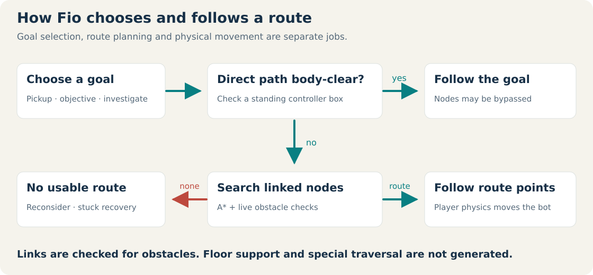
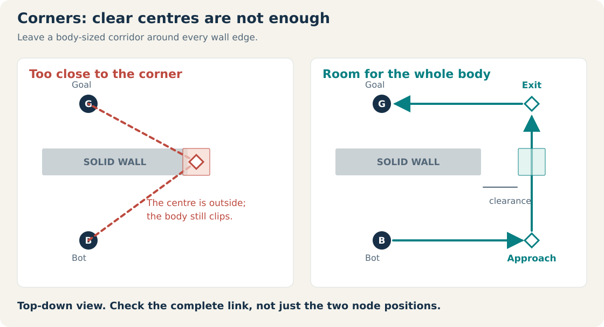
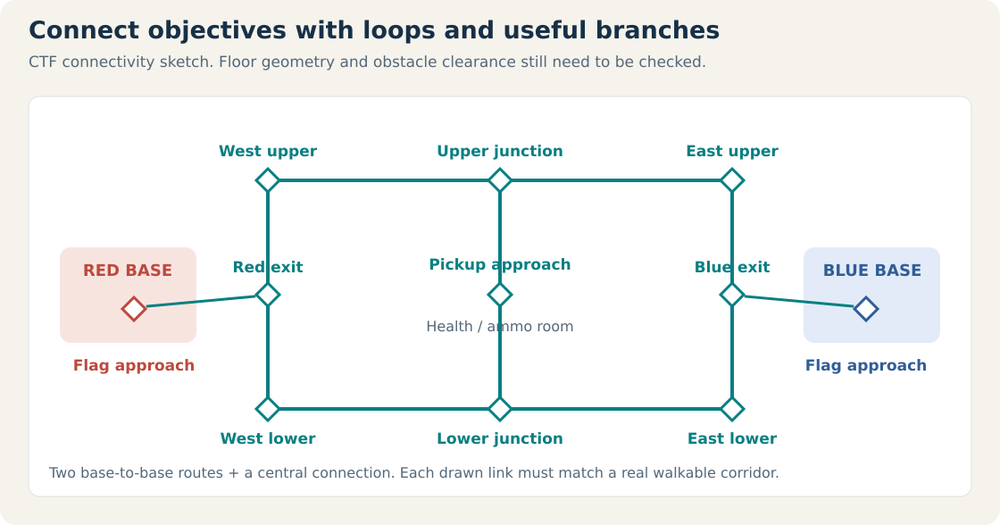
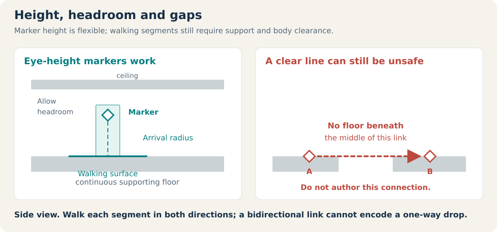
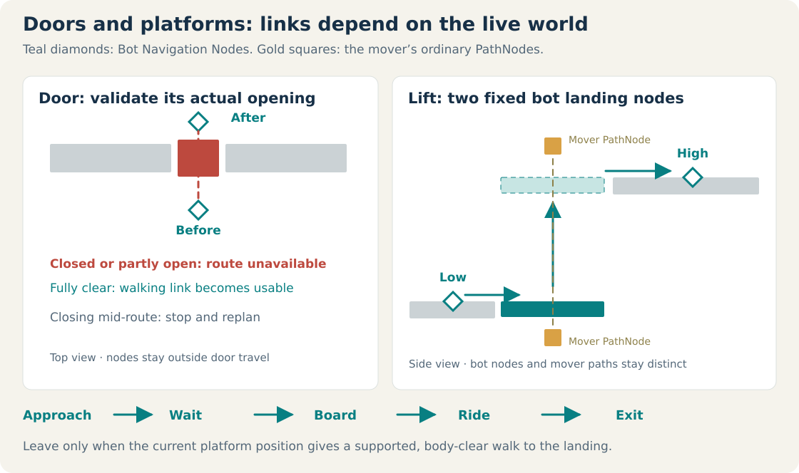
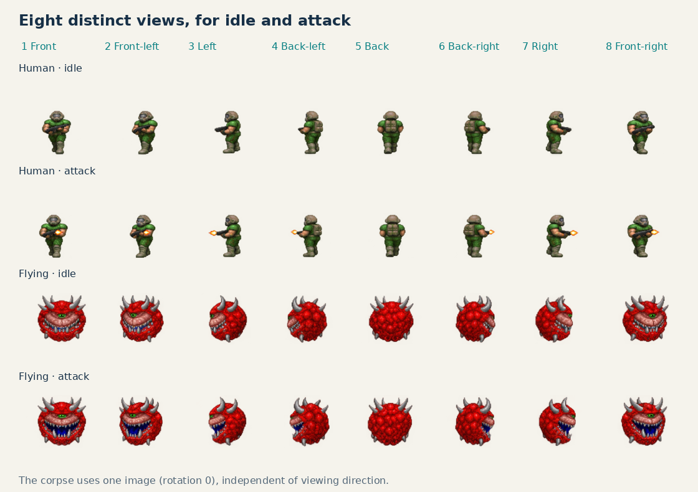

# Fio bot navigation: a level designer’s guide

How bots choose a path, where to place Navigation Nodes, and how to build routes that work in Deathmatch and Capture the Flag.

**Scope:** ground-monster PathNodes and Deathmatch Navigation Nodes, including height-tolerant markers and arrival radii. New Bot Navigation Nodes automatically connect to nearby reachable neighbours when placed; you can edit those links afterwards. This is a waypoint system with placement-time linking. A full automatic level navigation bake with optional authored hints remains planned. Quake III’s AAS navigation and fuzzy bot decisions are references for that work.

[Download the printable PDF](docs/navigation/Fio-Bot-Navigation-Guide.pdf).

## 1. What a bot actually follows

A **node** marks a destination area, with a configurable arrival **radius**. Its visible marker can be at any height: eye-height markers work for grounded bots. The walking destination is resolved onto the supporting surface near the bot’s current level. A **link** connects nodes; a **route** lists the walkable positions the bot follows.

Fio has two related authoring systems: ordinary monster **PathNodes** use `next_node` patrol chains; Deathmatch **Navigation Nodes** use bidirectional `links` and A*. Ground monsters measure arrival horizontally, so raising a marker does not force them to reach its exact Y coordinate. Flying monsters retain their actual 3D patrol destinations, allowing you to author flight altitude.

The current sequence is:

1. **Choose a goal.** Depending on the situation, a bot seeks a pickup, follows a CTF objective, investigates an opponent’s last known position, or roams between nodes. Visible enemies can trigger direct combat movement instead of waypoint following.
2. **Try the direct route.** If the controller’s full body can clear the straight segment and the segment has walkable floor support, the planner returns the goal directly. Nodes are not mandatory stops: a clear direct path takes precedence over them.
3. **Attach to the graph.** Deathmatch projects marker X/Z positions onto valid standing surfaces, then considers reachable start nodes, including valid floors at different heights. Goal-side nodes also need a supported walking connection or a validated platform transfer to the goal. The bot and goal do not need to stand exactly on nodes.
4. **Run A\*.** The planner adds the distance already travelled to an estimate of the remaining distance. Both use straight-line 3D distance; the estimate helps it search toward the goal. Every link is checked against live doors, movers, body clearance and floor support before use. Platform transfers add their walking and riding distances plus a wait penalty to the route cost.
5. **Move and reconsider.** The bot steers toward successive positions using Fio’s Player controller. A Navigation Node is reached within its radius; the bot can advance before reaching its exact centre when the next segment is clear. Large radii must not cause corner cutting. Routes are reconsidered periodically; stuck recovery attempts a jump and turn.

**A link expresses intent, not a guarantee.** The planner checks an expanded body-sized box against live brush obstacles and samples supporting floors along each walking segment. A platform route includes explicit approach, wait, board, ride and exit actions. Jump, ladder and teleport traversal instructions are not generated.

## 2. Put nodes at changes in movement

Start with **corners, junctions, doorway approaches, entrances to important rooms, and objective approaches**. Add a node where the bot needs a new clear segment, rather than filling every open room with a dense grid.

For each node and every link approaching it:

- Place the visible marker at a convenient height, including **eye height**. What matters is its horizontal location, arrival radius and a valid walking surface underneath. The marker itself does not need to touch the floor.
- Tune the **radius** to the space. A Deathmatch Navigation Node defaults to 36 units; ordinary PathNodes default to 256. Use smaller radii near tight turns or precise waits, and larger radii in open areas. Reaching a node means entering its arrival area, not touching its centre.
- Keep the bot’s whole body away from walls. The default standing controller is **50 units wide, 100 high and 50 deep**. Its centre needs more than 25 units of lateral clearance; exact contact leaves no working margin. Around ordinary corners, **40–64 units of clearance** is a useful starting point, then test the complete segment.
- Those dimensions describe **Deathmatch bots using the Player controller**. Ordinary Monster AI uses a more conservative **100-unit wall margin** around its position, approximately a 200-unit-wide movement footprint. Give stock monsters correspondingly wider routes; do not assume that a corridor suitable for a multiplayer bot will fit every monster.
- Put nodes far enough beyond corners that the joining segment clears the wall with the whole body. Two valid endpoint positions can still have an invalid diagonal between them.
- Place a node on **each side of a doorway**, outside the door’s travel volume. Check headroom and width. A closed door can invalidate a link; bots do not gain a door-activation plan merely because a node is nearby.
- Add intermediate nodes where a corridor bends. In a large open room, a few well-connected entrance/junction nodes are usually more useful than many collinear nodes.

There is **no required node spacing**. As a design starting point, try 128–256 units between important indoor decisions, then adjust for the geometry. Those values are suggestions, not engine thresholds.

### Deathmatch example: route around one wall

Coordinates are `(X, Y, Z)`, with Y up. Suppose the floor is at Y = 0, a wall is centred at `(0, 120, 150)` with size `(300, 240, 50)`, the bot starts at `(0, 0, 0)`, and the goal is `(0, 0, 300)`. The node markers below are deliberately at eye height.

| Node name | Marker position | `links` |
| --- | --- | --- |
| `East_Approach` | `(240, 90, 0)` | `East_Exit` |
| `East_Exit` | `(240, 90, 300)` | empty |

The bot resolves these markers to Y = 0, attaches to `East_Approach`, passes east of the wall, then leaves `East_Exit` for the goal. The wall ends at X = 150, so X = 240 leaves 90 units to its east edge. Routing tests cover this layout with markers below ground, at eye height and far above the level.

## 3. Create and connect nodes in the editor

For a playable arena, enable the Deathmatch plugin and provide **Match Settings**, a **Bot Opponent**, a normal **PlayerStart**, and suitable **Respawn Points**. Navigation Nodes alone do not activate a match or spawn bots. New Match Settings default to **50 frags**, **10 captures** and **30 minutes** (`time_limit = 1800` seconds); existing authored limits remain configurable.

1. Place a **Bot Navigation Node** from the **Plugins → deathmatch** entity menu. It automatically links to up to **six** nearby reachable Bot Navigation Nodes within its **`link_range`**, default **512 units** horizontally.
2. Put its X/Z position over a walkable part of the level. Its marker may be at floor, eye or another convenient height; inspect the actual floor and headroom in a side view.
3. Keep its generated unique name, or give it a **unique, case-sensitive name without spaces**, such as `West_Junction`. If you rename a node, update any `links` entries that refer to its old name.
4. Inspect the automatic links and fine-tune the `links` property. Remove unwanted names or add neighbours with Ctrl-K. Names are separated by commas or spaces: `North_Door, Health_Approach`.
5. Set `radius` to suit the arrival area; enable `show_radius` to preview it. Repeat at the next junction, then test the connecting segment in both directions.

**Automatic links are a starting point.** Placement checks static walls, supporting floors and potential platform transfers. A closed door may have a potential link across it, but the runtime route stays unavailable until the door physically clears the bot’s body. `auto_link` can be disabled for a node before calling its placement hook; changing it on an existing node does not regenerate links. Existing links are preserved when other nodes are placed, when loading a map and during Play. Moving a node afterwards keeps its links for you to review; runtime validation rejects links that have become unsafe.

**Recognise the node type:** Bot Navigation Nodes use a **teal diamond with an N**, and solid teal connections with arrows at both ends. Ordinary PathNodes retain their existing marker and dashed, olive `next` chain lines. These systems are visually and functionally distinct.

You can also select the source, press **Ctrl-K**, drag the arrow to the destination and release. Navigation Nodes gain a `links` entry; ordinary PathNodes gain a `next_node` link. See the editor workflow below.

**Links are bidirectional.** Listing `North_Door` in `West_Junction.links` creates both directions automatically; you do not have to repeat the reverse entry. This also means a link cannot describe a safe one-way drop. Misspelled names and self-links are ignored, while duplicate node names overwrite a graph entry. Use distinctive, consistent names.

## 4. Build a network, not a single chain

Deathmatch needs access to useful rooms and pickups. CTF needs reliable travel between bases, flag recovery positions and several approaches. Give important areas at least two routes where the map geometry allows it.

The diagram is a **connectivity sketch**: each line still needs body clearance and floor support in your actual level. Match links to actual corridors; never draw a connection through cover simply to make the graph look complete.

| Location | Best placement |
| --- | --- |
| Respawn area | Connect its safe exit to the main network. Spread spawns out and avoid forcing all traffic through one occupied spawn point. |
| Pickup | Put an approach node over the walkable floor within usable reach, with a clear final approach. The marker does not need to touch the floor or pickup sprite. |
| CTF flag/base | Connect a floor-level approach near the flag to both the attack routes and local defensive routes. Keep the flag’s touch area unobstructed. |
| Defensive position | Use a position with useful sightlines that remains connected to flag recovery and exit routes. A node itself does not assign a defender role. |
| Door/chokepoint | Provide a genuinely traversable alternate route if one exists. Check what happens when the door is shut. |

**Current pickup limitation:** bot item selection filters out occluded pickups before asking for a route. A hidden health pack may remain unselected even if nodes reach it. Keep useful pickups visible from common approaches when testing the current implementation.

CTF requires exactly one red and one blue **CTF Flag**, plus appropriate team spawns and Match Settings. A good node network helps bots reach their objectives; it does not create flag rules, choose team roles, or turn a map into CTF by itself.

## 5. Check floor support and vertical changes

The most important safety check is **whether a player can actually walk every linked segment in both directions**.

- Use side views to check the **bot’s walking surface and headroom**, rather than aligning the marker to an exact height. On stacked floors, the planner considers connected standing surfaces and validated platform transfers; marker height is not a command to change storeys.
- Do not connect across pits or between overlapping floors just because their top-down positions are close. A clear line through empty air is rejected as a walking connection when the sampled route lacks support.
- For ordinary stairs and ramps, put nodes at useful landings and bends, then test short links in both directions. Player physics supports steps and slopes, but the planner’s conservative brush-box approximation can still reject a physically walkable segment.
- Do not depend on planned jumps, ladders or teleports. A stuck bot’s jump attempt is reactive recovery, not a validated jump route. Supported lifts and translating platforms are handled as described below.
- Keep routes out of damaging or otherwise unsafe areas yourself. A* measures distance and a platform wait penalty; it does not model damage exposure or tactical risk.

### Closed doors and moving platforms

A closed or partly open door invalidates a route if it still intersects the standing bot’s body. The planner reads the door’s actual position, not just its open/closed command state. If a door closes after planning, the bot stops, discards the blocked route and searches again. Put nodes on both safe approaches and provide an alternate corridor where possible. Bots do not automatically press remote buttons or solve scripted door puzzles.

For a lift, put one Bot Navigation Node on the **fixed lower landing** and another on the **fixed upper landing**, with clear approaches to the platform. Place the mover’s own ordinary PathNodes along its travel path if using a path-driven mover. The teal bot nodes describe where a bot wants to go; the ordinary PathNodes describe where the platform moves.

Bots can wait for, board, ride and leave sufficiently large **active, cyclic translating platforms**, including linear lifts and chained PathNode movers. The route checks the body’s clearance throughout the predicted ride and requires supported boarding and exit walks. The mover carries the bot controller, so the bot remains standing on it instead of being left behind. A platform disappearing or becoming disabled cancels the trip and triggers replanning.

Give platforms room for a standing player and keep their whole travel corridor clear. Linear platforms must cycle; the planner does not invent a return trip for `move_once` motion. Disabled/stopped movers do not create new ride routes, and bots do not automatically enable them. Rotating movers, scripted transfers and moving-world synchronisation over LAN need separate support. These platform actions apply to Deathmatch/CTF bot controllers; ordinary monster patrols retain their native movement rules.

## 6. Test and diagnose the network

Test in Play with a bot and a useful destination on opposite sides of the geometry. Remove convenient direct sightlines where you want to exercise the waypoint route. For CTF, test both teams, flag carrying, dropped-flag recovery and return trips. Test doors open and closed.

| Symptom | Check first |
| --- | --- |
| Bot takes a direct path past your nodes | A clear direct route takes precedence; nodes are not forced patrol stops. |
| Bot stops at a wall or keeps turning/jumping | Check the missing corner node, link spelling, body clearance and whether the graph actually connects around the obstacle. |
| Bot falls into a gap | Inspect floor support along the link. Obstacle clearance alone does not make a walkable route. |
| Bot cannot reach another floor | Check a continuous, tested walking route. Use a supported walking route or an active platform with clear boarding and exit positions. A vertical link alone does not add a jump or ladder action. |
| Bot ignores a useful pickup | Check inventory need, pickup availability, visibility and a usable final approach, as well as the route. |
| Door closure strands a bot | Confirm that an alternate connected corridor exists and is open. Waypoints do not automatically activate doors. |

Finish by walking every link yourself, testing both directions, and watching bots use the network over several lives. Remove redundant nodes only after confirming that the remaining links still provide the required clearance and connections.

## 7. Eight-direction monster and bot sprites

All built-in human and flying monsters, their variants, and multiplayer bot appearances have eight distinct **idle** and **attack** views. The renderer chooses the view from the actor’s heading relative to each camera. It changes the image; rotating the same flat billboard is not a substitute.

| Rotation | View |
| --- | --- |
| 1 | Front |
| 2 | Front-left |
| 3 | Left |
| 4 | Back-left |
| 5 | Back |
| 6 | Back-right |
| 7 | Right |
| 8 | Front-right |
| 0 | Death: one corpse image, independent of viewing angle |

Custom idle and attack sets should supply `name_1.png` through `name_8.png`. In **Customise Monster Sprites**, selecting any numbered view identifies the whole set. Missing custom or variant views use the corresponding built-in directional view before a flat-image fallback. Keep every view present to preserve your custom appearance from all angles. Death uses the selected single corpse image.

Regular Monster AI publishes its movement/attack heading. Deathmatch publishes bot aim heading and shooting state; LAN snapshots carry heading and attack timing so clients select the same appropriate views. Separate cameras can show different views of one actor at the same time.

### CTF flag billboards and lights

The red and blue flags use matching transparent, camera-facing billboard sprites. At base or when dropped, the flag uses its full square sprite. On pickup, it becomes a smaller icon over the carrier’s body and follows that carrier on the host and LAN clients; dropping or returning it restores the full-size world flag.

**Both flags always emit their own colour of light** during CTF: red light from the red flag and blue light from the blue flag. The light stays with the flag at home, while dropped and while carried. Flag lights use a 320-unit radius and start without shadow casting.

Type **`dflaglight`** or **`dflaglight on`** to make both flag lights cast dynamic shadows in your own view. **`dflaglight off`** disables shadow casting while keeping their coloured illumination on. This is a **per-client rendering setting**, including on the host: it is never sent to other clients or changed by multiplayer snapshots. It lasts for the current Play session, including round restarts, and the renderer’s global shadow settings still apply.

## 8. Inspect decisions with `botdebug`

Type **`botdebug`** in the console to open a floating, non-modal Bot Debug window. It works in the editor and Play mode and includes an **Overview** plus **one tab per bot**. Names, additions and removals update live.

The overview shows controller, decision/state, target, health, route length and weapon. A Deathmatch bot’s tab shows visibility, last known position, memory and reaction/shot timers, team/flag state, next waypoint, goal, blocked-route reason, mover name and traversal phase, stuck recovery, inventory and pickup target. Ordinary monster tabs show actual patrol chains, waits, detours and combat state. Each tab keeps a short history of observed decision changes.

The panel refreshes twice per second (every 500 ms) while visible and stops polling when closed. If the simulation is busy, it retains the previous sample rather than blocking the game. `botdebug off` closes it. In a LAN client, host decision details are not replicated; the panel labels those bots **Replicated**. Run it on the host to inspect their actual AI decisions.

## 9. Connect entities with Ctrl-K

1. Select **one source entity** in the editor.
2. Press **Ctrl-K**.
3. Left-drag the arrow onto the destination entity in a 2D or 3D view.
4. Release to create the connection. **Esc** or a right-click cancels.

| Source → destination | Created link |
| --- | --- |
| PathNode → PathNode | `next_node` patrol-chain link |
| Bot Navigation Node → Bot Navigation Node | Bidirectional Deathmatch `links` connection |
| Monster → PathNode | `patrol_target`, with patrol enabled |
| Logic Camera / Spawner → PathNode | Camera path / spawn target |
| Portal → Portal | Portal target |
| Trigger or other I/O entity → compatible target | Declared output/input connection, such as `OnTrigger → Open` for a door |

I/O connections use a stable target ID. The toast identifies the chosen output and input; use the I/O editor to adjust the action, delay or parameters. Unsupported pairs are rejected without changing the map. Repeating the same connection does not create a duplicate. Each completed link is one undoable edit; dragging does not move either entity.

## Reference: where this behaviour lives

- [Navigation graph and A*](navigation.py): name-based links, direct route check and reachable start/goal connections.
- [Live navigation world](moving_navigation.py): walk support, door clearance, mover prediction and platform reachability.
- [Placement linking](authoring.py): one-time neighbour connections for new bot nodes.
- [Deathmatch runtime](runtime.py): route validation, platform phases, goal following, perception and movement.
- [Bot supplies](supplies.py): pickup desirability, visibility filtering and route-distance scoring.
- [CTF/team logic](teams.py): flag state and bot objective selection.
- [Routing tests](tests/test_deathmatch.py): `test_waypoints_route_around_wall_and_reject_closed_path`.
- [Bot Debug window](../../editor/bot_debug.py): live snapshots, overview and per-bot decision history.
- [Ctrl-K linking](../../editor/entity_linking.py): drag feedback and native link creation.

Quake III separates **reachability/routing** from **goal desirability** and **behaviour states**. Its [AAS routing](https://github.com/id-Software/Quake-III-Arena/blob/master/code/botlib/be_aas_route.c), [fuzzy weights](https://github.com/id-Software/Quake-III-Arena/blob/master/code/botlib/be_ai_weight.c), and [CTF team decisions](https://github.com/id-Software/Quake-III-Arena/blob/master/code/game/ai_team.c) are useful references. Fuzzy logic helps choose what to pursue; it does not establish that the floor, doorway or jump is traversable.
