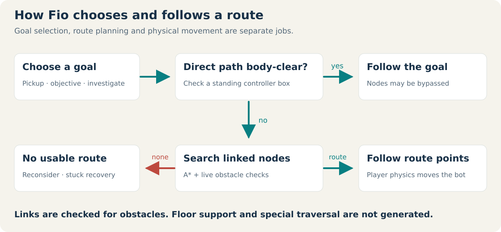
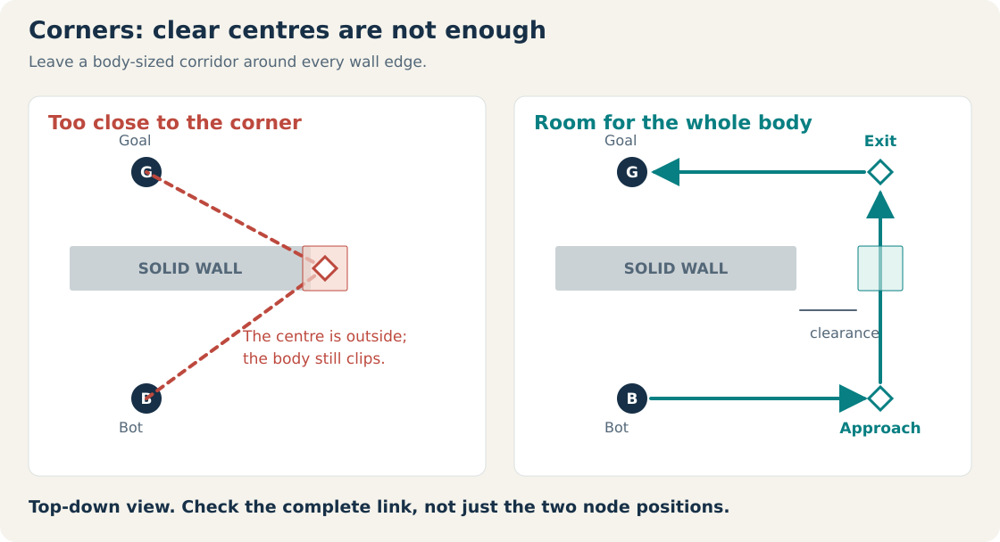
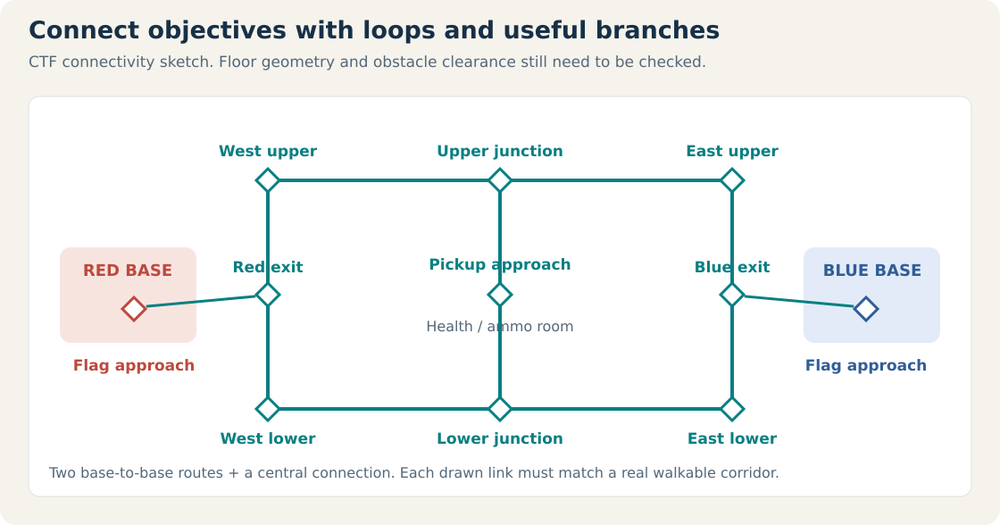
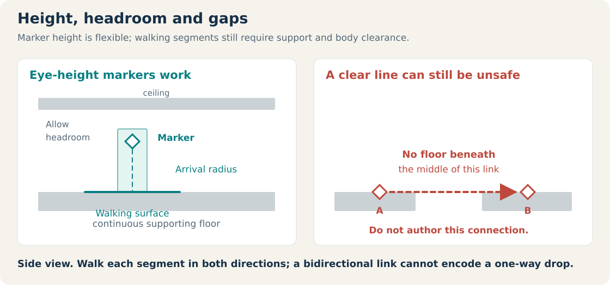
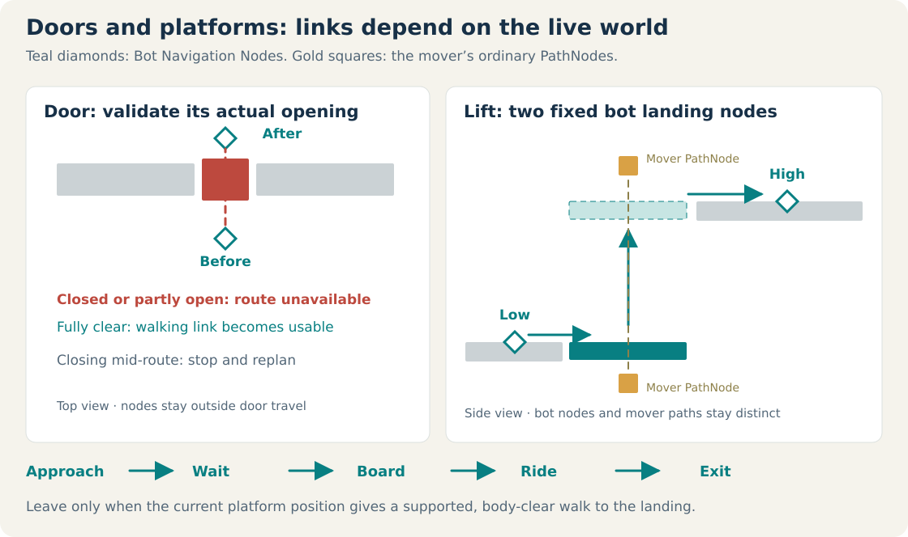

> Applies to Fio 3.1.0.0611 (CANARY).

**Deathmatch** (`plugins/deathmatch/`) adds free-for-all Deathmatch, Team Deathmatch and Capture the Flag with bots and LAN play. It runs in the editor's Play mode and in the [Android player](https://github.com/ViciousSquid/Fio/wiki/Fio-Player-(Android)). It ships off and turns on for a map that contains its entities. Its files carry `SPDX-License-Identifier: GPL-2.0-or-later` and the folder has its own `LICENSE` (GNU GPL version 2).

## Playing

**Plugins > deathmatch > Load Demo map** (or **Load CTF map**), then Play. Keys 1/2 select pistol/shotgun (both given at spawn, with 24 shotgun rounds); **Tab** shows the scoreboard; **R** restarts after a match, and the pause menu has Restart Deathmatch.

Rules: a kill is one frag; a suicide or world death subtracts one; deaths respawn after `respawn_delay`; a new spawn is protected for `spawn_protection` seconds or until it fires. Tied totals are a draw.

## Entities

| Entity | Properties (defaults) |
| --- | --- |
| **Match Settings** (`deathmatchsettings`) -- exactly one; a map without it stays inert | `game_type` (`deathmatch`; `teamdeathmatch`, `ctf`), `frag_limit` (50), `time_limit` (1800 s), `respawn_delay` (3), `spawn_protection` (1.5), `seed` (42), `show_hud` (true), `player_team` (`red`), `friendly_fire` (false), `capture_limit` (10), `flag_return_time` (40), `team_skins` (true). Zero disables a limit. |
| **Respawn Point** (`deathmatchspawn`) -- at floor height | `angle` (0 = +Z, 90 = +X), `team` (`any`) |
| **Bot Navigation Node** (`deathmatchnode`) | `links` (comma-separated names), `radius` (36), `auto_link` (true), `link_range` (512), `show_radius` |
| **Bot Opponent** (`deathmatchbot`) | `skill` (`normal`; `easy`, `hard`), `max_health` (100), `vision_range` (1800), `hearing_range` (1000), `field_of_view` (160), `preferred_range` (480), `team` (`auto`) |
| **CTF Flag** (`deathmatchflag`) | One red and one blue, at floor height. |

A normal Player Start is still needed so Play can begin.

## Console

Available only while the plugin is enabled:

| Command | Effect |
| --- | --- |
| `addbot ["Name"] [easy|normal|hard] [red|blue]` | Add a bot. |
| `removebot ["Name" or id]` | Remove a bot (the last one by default). |
| `fraglimit [n]` | Show or set this session's frag limit; 0 disables it. |
| `spectate` | Spectator mode. |
| `dflaglight` | Flag lighting. |

`botdebug [on|off]` (a core, user-only command) opens the bot diagnostics window (`editor/bot_debug.py`). Changes last for the Play session; stopping Play restores the authored map.

## Bots

Bots fight every opponent. Sight uses field of view, range and real occlusion; gunfire is heard and investigated. They keep a preferred distance, strafe, retreat when hurt, seek weapons, ammunition and health (collecting ordinary [Props](https://github.com/ViciousSquid/Fio/wiki/Prop) through the same path as the player) and fire with a collected weapon's own mode, damage, pellets, spread and cooldown. `skill` changes reaction delay, aim error and firing interval. They move with the player's physics.

### Navigation

A* over authored waypoints; this is not a navmesh. A new node links automatically to up to six reachable neighbours within `link_range`; **Ctrl-K** dragging adds a link by hand; links work both ways and are not regenerated on load. Edges are validated live against walls, unsupported gaps and doors, and bots can wait for, board, ride and leave cyclic platforms. It does not plan deliberate jumps, ladders or rotating movers. Full guide: `plugins/deathmatch/NAVIGATION_GUIDE.md`.

## Teams and CTF

Team modes use red and blue; `auto` balances. Friendly fire is off by default. In CTF, take the enemy flag to your base while your own is home; a carrier drops the flag on death or removal; touching your dropped flag returns it, and an unattended flag returns after `flag_return_time`. Frag limits do not end a CTF game; `capture_limit` does.

## LAN

**Plugins > deathmatch > LAN Multiplayer...** hosts or joins. The host is authoritative: it simulates movement, combat, pickups, respawns and flags; a guest sends inputs and receives snapshots. Modules: `lan.py` (transport), `network_game.py` (`HostGame`, `ClientGame`), `lobby.py`.

| | |
| --- | --- |
| Discovery | UDP **27960**. Query `{"protocol": "fio-arena-1", "type": "discover"}`; a host answers with an `offer` (`name`, `mode`, `port`, `players`, `capacity`). At most 64 offers are taken per scan. |
| Game | TCP **27961**. Each message is a 4-byte big-endian length and a JSON object, at most 1 MiB. |
| Guest -> host | `hello` (`protocol`, `name`, `team`, `glasses`), `input` (`keys`, `angle`, `pitch`, `weapon`, `shoot`, `use`), `spectate` (`enabled`, `target`) |
| Host -> guest | `welcome` (`protocol`, `you`, `name`, `map`), snapshots ten times a second, `error` |
| Capacity | 8 players (the host and 7 connections). |
| Liveness | A frame must complete within 10 s; an idle side sends `{"type": "ping"}` every 2.5 s, which the transport swallows. A connection that has not said `hello` within 10 s is dropped. A guest sending more than 200 messages a second is dropped. |
| Validation | Every guest message and every snapshot is checked whole before it touches the match; names become one printable line; a map whose `welcome` would exceed 1 MiB is refused at hosting. |

Only JSON crosses the wire: peers need the same assets and plugins installed. The host's map is map *logic*, though, like any map file -- it can contain `logic_command` entities and level changers -- so join only hosts you would accept a map from.

Tests: `plugins/deathmatch/tests/` (including `test_lan_hardening.py`).
