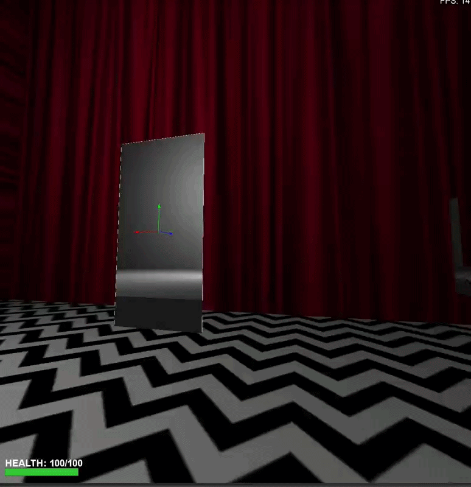

> Applies to Fio 3.1.0.0611 (CANARY).

A **Portal** (`type: "portal"`, class `editor.things.Portal`) is a window onto another place that the player can walk through. Two portals are linked through `portal_target`. Example: `maps/Portal_Test.json`. Rendering: [Portal Rendering ‐ Technical Overview](https://github.com/ViciousSquid/Fio/wiki/Portal-Rendering-%E2%80%90-Technical-Overview).

In the editor a portal shows its aperture as a wireframe, not a sprite.

## Properties

| Key | Type | Default | Meaning |
| --- | --- | --- | --- |
| `portal_target` | string | `""` | Name of the partner portal. |
| `active` | bool | `true` | Open or closed (see below). |
| `width`, `height` | float | `128`, `256` | Aperture size. |
| `angle` | float (degrees) | `0.0` | Yaw. |
| `rotation` | [x, y, z] | zeros | Orientation. |
| `portal_direction` | string | `both` | Which side(s) can be entered. |
| `color` | [r, g, b] 0-255 | white | Rim colour. |
| `show_rim` | bool | `true` | Draw the rim. |
| `glasses` | bool | `true` | Whether glasses are shown through it. |
| `parent_mover`, `parent_offset` | string, [x, y, z] | `""`, zeros | Attach to a mover. |

## Linked portals share one active state

Portals linked by `portal_target` -- either way round, and through chains of links -- are always all active or all inactive (`editor/portal_links.py`). `Enable`, `Disable` and `Toggle` on one switch them all, as do the console commands, the property panel and linking (the newly linked portal takes the edited portal's state). Only the portal that was sent the input fires its output. A map or save whose linked portals disagree loads with all of them inactive.

## Inputs

`Enable`, `Disable`, `Toggle`, `SetColor` (color), `SetTarget` (string), `ShowRim`, `HideRim`, `SetWidth` (float), `SetHeight` (float).

## Outputs

`OnEnabled`, `OnDisabled`, `OnToggled`, `OnTeleport`, `OnPlayerEnter`.

Console: `portal_list`, `portal_create <name1> <name2> [x y z]`, `portal_link <name> <target>`, `portal_color <name> <R> <G> <B>`, `portal_enable <name>`, `portal_disable <name>`, `portal_delete <name> [and_pair]`. Runtime: `engine/logic_portals.py`, `engine/portal_transform.py`.
